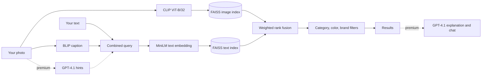

# Look-Buy-AI

A multimodal product search app. Upload a photo of something you like, type a description, or both, and it finds matching products from 10,000 real Amazon listings. Image search and text search run side by side and are merged with weighted rank fusion. An optional GPT-4.1 layer reads your photo for hints, explains why each result matches, and answers follow up questions about the results.

## Features

| Feature | What it does |
|---|---|
| Image search | CLIP embeddings find products that look like your photo |
| Text search | Sentence embeddings find products that match your words |
| Hybrid ranking | Merges both result lists with weighted reciprocal rank fusion |
| Auto captions | BLIP describes your photo, so the text search can use it too |
| Search modes | Hybrid, image first or text first, each with its own weights |
| Filters | Category, color and brand, typed or detected from the query |
| Premium hints | GPT-4.1 reads the photo and suggests brand, category, color and a short query |
| Explanations | GPT-4.1 explains why the top results match, using only those results |
| Shopping chat | Ask follow up questions about the products on screen |

## How it works



1. **Build the catalog.** Scripts download product listings and images from the Amazon Berkeley Objects dataset and keep 10,000 English products.
2. **Index images.** Each product image is embedded with CLIP ViT-B/32 and stored in a FAISS index.
3. **Index text.** Each product's title, brand, category, color and a BLIP generated caption of its image are embedded with all-MiniLM-L6-v2 and stored in a second FAISS index.
4. **Search.** Your photo goes to the image index. Your text, plus the BLIP caption of your photo, goes to the text index.
5. **Fuse.** The two ranked lists are merged with reciprocal rank fusion. Hybrid mode weights image 55% and text 45%. Image first mode uses 75 to 25, and text first uses 30 to 70.
6. **Explain.** With premium on, GPT-4.1 explains the top matches and answers questions, grounded only in the products shown.

The dataset has no prices or ratings, so the app shows stable demo values for those and labels them as demo values.

## Tech stack

| Area | Tools |
|---|---|
| Image | OpenCLIP ViT-B/32, BLIP captioning |
| Text | sentence-transformers all-MiniLM-L6-v2 |
| Search | FAISS, reciprocal rank fusion |
| LLM | OpenAI GPT-4.1 for hints, explanations and chat |
| App | Streamlit |
| Data | Amazon Berkeley Objects, pandas, Parquet |

## Project structure

```
app/app.py          Streamlit app: search, fusion, filters, explanations, chat
scripts/            Build the catalog and indexes, steps 01 to 13 in order
tools/              Embed or caption a single uploaded image
data/               Product data, images and FAISS indexes
```

## Running it

```bash
pip install -r requirements.txt
export OPENAI_API_KEY="your_key"     # only needed for premium features
streamlit run app/app.py
```

To rebuild the catalog and indexes from scratch, run the scripts in order:

```bash
bash scripts/01_download_metadata.sh
python scripts/02_build_products_10k.py
python scripts/03_download_images.py
python scripts/04_build_text_index.py
python scripts/06a_embed_images_clip.py
python scripts/06b_build_faiss_image_index.py
python scripts/10_build_blip_captions_10k.py
python scripts/11_merge_captions_into_products.py
python scripts/12_build_metadata_fields.py
python scripts/13_rebuild_text_index_enriched.py
```

Scripts 05, 07, 08 and 09 are command line tools to try each search on its own.

## Author

Siddhesh Patil, MS in Artificial Intelligence, DePaul University
